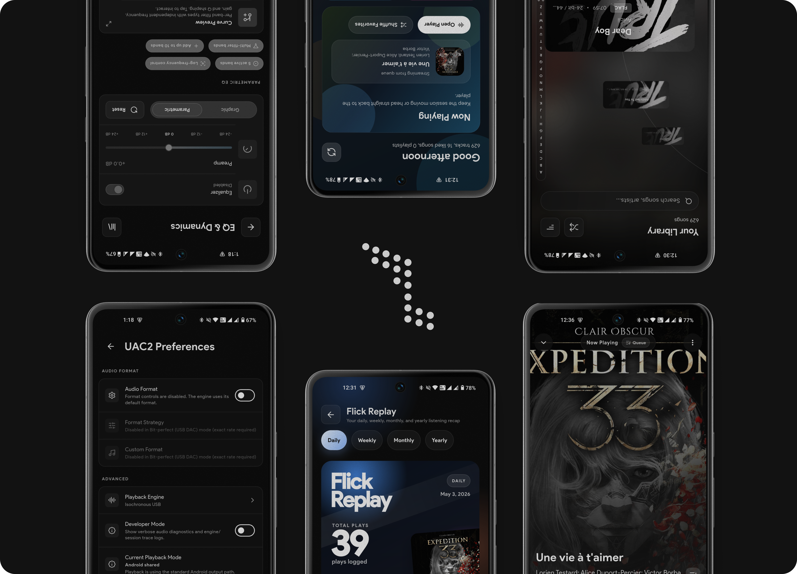
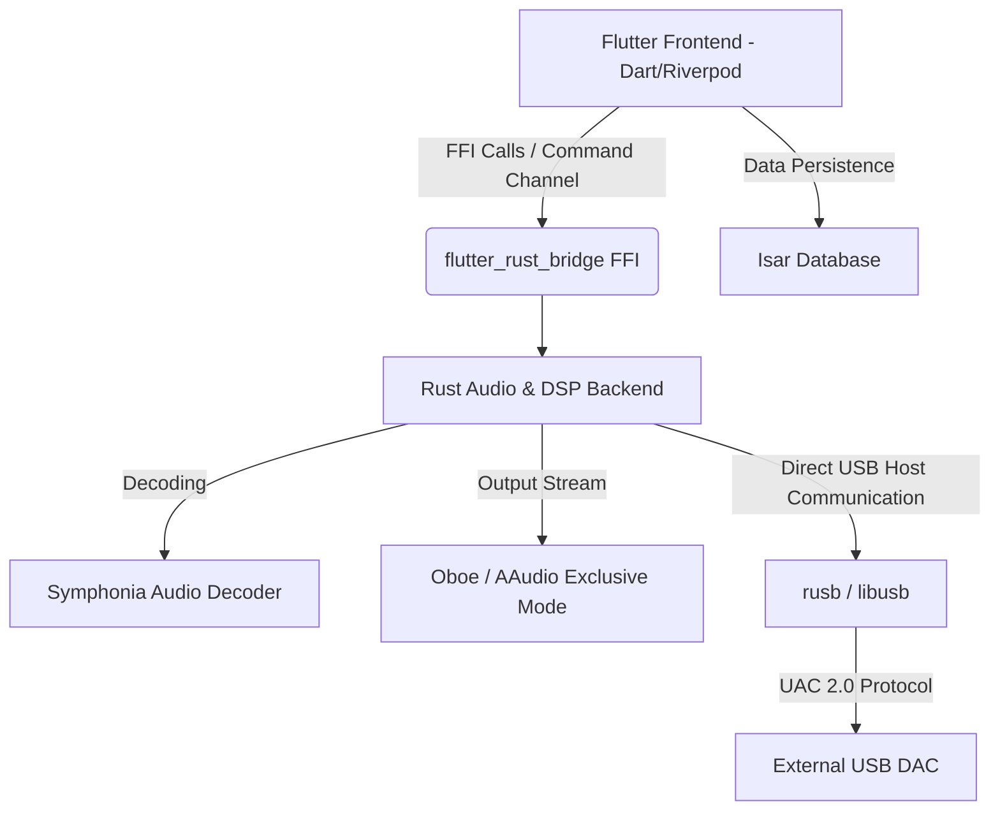

# Intense Audio Player

<p align="center">
  
</p>

## Project Submission Metadata
- **Student Name:** PATEL AUM SHIRISHKUMAR
- **Enrollment Number:** 12302040601004
- **Branch:** CP (Computer Programming)
- **Academic Year / Semester:** 2026
- **Project Title:** Intense Audio Player (A High-Performance Audiophile Music Player for Android)

---

## Project Overview

**Intense Audio Player** is a state-of-the-art, high-fidelity music player developed for Android devices. Designed specifically for audiophiles, the application bypasses the standard Android audio mixer (which degrades quality through forced resampling) to provide bit-perfect output directly to external USB DACs and high-resolution digital audio player (DAP) hardware. 

The core playback and digital signal processing (DSP) engine is implemented in **Rust** for bare-metal performance, memory safety, and timing precision, while the frontend is constructed using **Flutter** for a premium, highly responsive user experience.

---

## Key Features

- **Rust Audio Engine:** Bit-perfect USB DAC output (UAC 2.0), native DSD (DSF/DFF/WavPack), DSD-over-PCM (DoP), and DAP high-resolution audio via Oboe/AAudio exclusive mode. Automatically falls back to the standard Android audio pipeline when direct routing is unavailable.
- **Advanced DSP Pipeline:** Integrated 31-band parametric equalizer with dynamic range compression/limiting, convolution reverb using custom Impulse Response (IR) files, gapless playback, and configurable crossfading.
- **Smart Media Library:** High-speed MediaStore scanner with differential sync, external storage (SD Card and USB) mounting using Storage Access Framework (SAF), embedded metadata writer, and album art retrieval from MusicBrainz/iTunes/Deezer. CUE sheet parser, EAC rip log support, and duplicate file detection.
- **Synced Lyrics:** Dynamic lyrics retrieval via LRCLib.net, a built-in interactive LRC synchronizer/editor, and plain text fallback.
- **Native Widgets:** Custom 2x2 compact and full-sized Android Home Screen widgets designed with Jetpack Glance, retaining active controls even if the system terminates the main application.
- **Intense Replay:** In-app and shareable listening statistics (daily/weekly/monthly/yearly recaps) exported as formatted high-resolution graphics.
- **Additional Enhancements:** Last.fm and ListenBrainz scrobbling, adaptive material palette styling extracted from album art, sleep timer, real-time FFT visualizer, and custom animated vinyl disc layouts.

---

## Technical Stack & Architecture

The application implements a hybrid architectural model, leveraging the strengths of cross-platform Dart and systems-level Rust:



- **Frontend:** Flutter, Dart, Riverpod (State Management), Isar Database (Local Cache).
- **Backend:** Rust, Symphonia (Decoder Crate), rusb (USB Communication), cpal/Oboe (HAL Output), lofty (Audio Metadata).
- **Inter-process Communication:** `flutter_rust_bridge` (automatic generation of safe FFI bindings).

---

## How to Build and Run

### Prerequisites
1. **Flutter SDK** (version 3.10.4 or higher).
2. **Rust Toolchain** (installed via rustup).
3. **Android NDK** (setup in your local environment for cross-compilation).

### Build Commands
To retrieve dependencies and compile the project locally:

```bash
# Retrieve Flutter package dependencies
flutter pub get

# Fetch Cargo dependencies and generate bridge code
cd rust && cargo fetch && cd ..

# Compile and launch the app in debug mode on a connected device
flutter run
```

To compile the production-ready Android package:
```bash
flutter build apk --release
```

---

## Documentation

Comprehensive design and implementation details are available in the following system documents:
- [DSD Architecture Guide](file:///e:/Projects/Intense/Intense-main/docs/DSD_ARCHITECTURE.md)
- [Library Scanner and Sync Engine](file:///e:/Projects/Intense/Intense-main/docs/LIBRARY_SCAN_ARCHITECTURE.md)
- [Hardware Volume Control Quirks](file:///e:/Projects/Intense/Intense-main/docs/hardware_volume_control.md)
- [USB Audio Class 2.0 (UAC2) Specification Checklist](file:///e:/Projects/Intense/Intense-main/docs/uac2/UAC2_IMPLEMENTATION_CHECKLIST.md)

---

## License & Acknowledgments
Distributed under the MIT License. Built with custom contributions and developed through systems engineering expertise.
